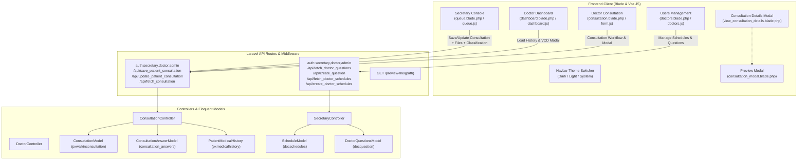

# Comprehensive App Fixes & Enhancements Implementation Plan

This implementation plan details the architecture and step-by-step strategy for resolving known issues and implementing requested updates across the Secretary Console, Doctor Dashboard, Doctor Consultation, User Management, Masterlists, Printables, and Global Theme Switcher.

---

## 1. Goal Description

Implement system-wide updates and bugfixes across 8 key functional areas:
1. **Financial Report Printable**: Remove standalone CO-PAY column and rename Total PAID column to CO-PAY.
2. **Secretary Console (Admin & Secretary Access)**:
   - Make the Patient Consultation Form responsive across all screen sizes.
   - Remove the "Details" button from the Patient Queue card.
   - Update Medical History: Add future-update button "Yakap Medical History/Profiling" and rename "Surgical History" to "Surgical/Operations History".
   - Add Patient Classification selector (MEDICAL, PEDIA, OBSTETRICS, GYNECOLOGY, NEW BORN, ORTHO, DENTISTRY, DERMA, HEMODIALYSIS, OTHERS) above Chief Complaints with dynamic classification fields inserted after Temperature based on temp reference files.
   - Rename Patient Type option "PHIC" to "PHIC YAKAP".
   - Fix saving, loading, and previewing of Radiology and Laboratory files for queued patients.
   - Provide a dedicated Consultation Details modal with Medical History displayed as a tab.
3. **Users Management (Admin Access)**:
   - Fix unable to set doctor schedules and doctor questions from Doctor Management modal.
4. **Dashboard Page (Doctor Access)**:
   - Fix DataTables error on `#todays_patients_table` (header/body column mismatch).
   - Update Today's Patients row click / Details action to show patient consultation history list first; clicking a consultation record opens the complete Consultation Details modal.
   - Include Medical History tab, Patient Classification & additional fields, Answered Doctor's Questions, and a standalone file preview modal for Radiology and Laboratory.
5. **Consultation Page (Doctor Access)**:
   - Display Queue Number alongside Patient Name in the consultation patient list.
   - Fix consultation modal vertical tab overlap and unclosed div blocking Medical History content from rendering.
   - Resolve `Blocked aria-hidden on an element because its descendant retained focus` modal warnings.
   - Mirror consultation details: Patient info & vital signs (classification + fields), Answered questions, and file preview modal.
6. **Patients Masterlist (Doctor & Admin Access)**:
   - Remove the "Details" button from the masterlist actions.
7. **Theme Switcher (Header)**:
   - Add Dark, Light, and System theme mode toggle in the top navbar header with persistence.
8. **Simulated QA & Validation**:
   - Execute 12-step simulated workflow with test credentials (`ADMIN`: admin/admin123, `SECRETARY`: Doe/12345, `DOCTOR`: Jackson/12345) and inspect UI/backend logs.

---

## 2. User Review Required

> [!IMPORTANT]
> **Database Schema Dual-Update**:
> To persist `LMP Date` and `Delivery Procedure` alongside existing OB/GYN columns (`gravida`, `para`, `abortion`, `iufd`, `died`, `pathologic`, `infacilitydelivery`) in `pxwalkinconsultation`, a defensive migration will add:
> - `lmp_date` (DATE, NULL)
> - `delivery_procedure` (VARCHAR(50), NULL)
> In lockstep, [.gemini/database/kayakapmdv2_data_dictionary.md](file:///C:/xampp/htdocs/kayakapmd_clinic/.gemini/database/kayakapmdv2_data_dictionary.md) will be updated.

> [!NOTE]
> **Test Accounts**:
> The QA simulation requires accounts for `Doe` (Secretary) and `Jackson` (Doctor). We will ensure these accounts exist with password `12345` and are properly assigned so the end-to-end 12-step flow executes cleanly.

---

## 3. Architecture & Request Flow



---

## 4. Proposed Changes

### Component 1: Financial Report Printable (`resources/views/printables/financial_report_print.blade.php`)

#### [MODIFY] `resources/views/printables/financial_report_print.blade.php`
- Remove the standalone `Co-Pay` column (`<th>` and `<td>` with `$item->copay`).
- Rename the `Total Paid` column header to `CO-PAY`.
- Maintain the patient collected amount (`$item->paid`) under the `CO-PAY` header.
- In summary totals row, remove the `$summary->total_copay` cell and keep `$summary->total_paid` under `CO-PAY`.
- Update table column spans from 14 to 13.

---

### Component 2: Secretary Console & Patient Consultation Form

#### [MODIFY] `resources/views/pages/secretary/queue.blade.php`
- **Responsiveness**: Refactor patient information and vital signs input rows from unnested/rigid `d-flex` layouts to responsive Bootstrap grid containers (`<div class="row g-2">` with appropriate `col-12 col-md-...`).
- **Medical History Card**:
  - Add button `<button type="button" class="btn btn-sm btn-outline-info fw-bold" id="btn_yakap_medhistory_future" title="For future updates only"><i class="fa-solid fa-file-medical me-1"></i> Yakap Medical History/Profiling</button>`.
  - Rename label "Surgical History" to `Surgical/Operations History`.
- **Patient Classification**:
  - Add classification select above Chief Complaints:
    ```html
    <div class="mb-2">
        <label class="form-label fw-bold m-0" for="patient_classification">Patient Classification</label>
        <select class="form-select form-select-sm" name="patient_classification" id="patient_classification">
            <option value="MEDICAL" selected>MEDICAL</option>
            <option value="PEDIA">PEDIA</option>
            <option value="OBSTETRICS">OBSTETRICS</option>
            <option value="GYNECOLOGY">GYNECOLOGY</option>
            <option value="NEW BORN">NEW BORN</option>
            <option value="ORTHO">ORTHO</option>
            <option value="DENTISTRY">DENTISTRY</option>
            <option value="DERMA">DERMA</option>
            <option value="HEMODIALYSIS">HEMODIALYSIS</option>
            <option value="OTHERS">OTHERS</option>
        </select>
    </div>
    ```
  - Insert dynamic classification container after Temperature / Vital Signs:
    - **MEDICAL**: Sub-classification dropdown (`Adult`, `Pedia`).
    - **OBSTETRICS**: OB/GYN Case History (Gravida, Para, Abortion, IUFD, Died, LMP Date) + Delivery Procedure (Normal, Cesarean, Others) + Pathologic Case checkbox.
    - **GYNECOLOGY**: OB/GYN Case History (Gravida, Para, Abortion, IUFD, Died, LMP Date) + Pathologic Case checkbox.
    - **NEW BORN**: Procedure source radio (`Admission (from outside)`, `In-Facility Delivery`) + Delivery Procedure (`Normal`, `Cesarean`, `Others`) + Pathologic Case checkbox.
- **Patient Type**: Rename dropdown `<option value="phic">PHIC</option>` label to `PHIC YAKAP`.
- Include `@include('modals.consultation_modal')` or preview modal structure so file preview operates on a dedicated modal.

#### [MODIFY] `resources/js/pages/secretary/queue.js`
- **Patient Queue Table**: Remove `.view-consultation-details-btn` from `patients_queue_table` action column.
- **Radiology & Laboratory File Handling**:
  - Ensure file inputs (`radiologypath`, `laboratorypath`) bind change events for instant local preview or enabling preview eye buttons.
  - On `import-queue`, populate `#preview_radiology` and `#preview_laboratory` data attributes with resolved file preview URLs and enable the preview buttons.
  - Wire `#preview_radiology` and `#preview_laboratory` to open `#preview_modal` with document iframe or image preview.
- **Classification Handlers**:
  - Listen to `#patient_classification` change and toggle corresponding input sections.
  - In `save_consultation_btn` and `update_consultation_btn`, append classification fields (`patient_classification`, `subclassification`, `gravida`, `para`, `abortion`, `iufd`, `died`, `lmp_date`, `delivery_procedure`, `infacilitydelivery`, `pathologic`) to `FormData`.
  - When importing a queued patient, populate `#patient_classification` and all related fields.

---

### Component 3: Database Migration & Data Dictionary Synchronization

#### [NEW] `database/migrations/2026_10_12_210000_add_classification_details_to_pxwalkinconsultation_table.php`
- Add `lmp_date` (DATE, NULL) and `delivery_procedure` (VARCHAR(50), NULL) with `Schema::hasTable` and `Schema::hasColumn` idempotent guards.
- Implement reverse rollback in `down()`.

#### [MODIFY] `.gemini/database/kayakapmdv2_data_dictionary.md`
- Document `lmp_date` and `delivery_procedure` under `pxwalkinconsultation`.

#### [MODIFY] `app/Models/ConsultationModel.php`
- Add `lmp_date`, `delivery_procedure`, `classification`, `subclassification`, `gravida`, `para`, `abortion`, `iufd`, `died`, `pathologic`, `infacilitydelivery`, `linkaccount` to `$fillable`.

---

### Component 4: Backend Consultation Controller (`app/Http/Controllers/ConsultationController.php`)

#### [MODIFY] `app/Http/Controllers/ConsultationController.php`
- **File Upload Keys**:
  In `saveConsultation`:
  - Check `$request->file('radiologypath') ?? $request->file('radiology_file')`.
  - Check `$request->file('laboratorypath') ?? $request->file('laboratory_file')`.
  In `updateConsultation`:
  - Preserve existing paths when no new file is uploaded, and update when new file is supplied.
- **Classification Persistence**:
  - Map `classification`, `subclassification`, `gravida`, `para`, `abortion`, `iufd`, `died`, `lmp_date`, `delivery_procedure`, `infacilitydelivery`, `pathologic` in `$consultationData`.
- **`fetchConsultation` Payload**:
  - Generate full URLs for `radiology_url` and `laboratory_url` using `route('preview.file', ['path' => $consultation->...])`.
  - Return answered doctor's questions with question titles and answers.
  - Return all patient classification fields.

---

### Component 5: Users Management — Doctors Schedules & Questions (`routes/api.php`, `SecretaryController.php`, `doctors.js`)

#### [MODIFY] `routes/api.php`
- Resolve duplicate route definition for `create_doctor_schedules`.
- Ensure routes for `fetch_doctor_questions`, `create_question`, `fetch_doctor_schedules`, `create_doctor_schedules`, `edit_schedule`, `delete_schedule` are protected by `auth:secretary,doctor,admin`.

#### [MODIFY] `app/Http/Controllers/SecretaryController.php`
- In `createQuestion`: Support admin, secretary, and doctor authenticated users; correctly query doctor details using `docfname`, `docmname`, `doclname`, `docname` from `DoctorsProfileModel`.
- In `createSchedule`: Properly support schedule creation by admin with specified `docrefno`.

#### [MODIFY] `resources/js/pages/admin/users/doctors.js`
- Ensure event handlers for `#create_question_btn`, `#add_schedule_btn`, `.edit-question`, `.delete-question`, `.edit-schedule`, and `.delete-schedule` within `#manage_doctor_modal` are active and cleanly refresh the questions and schedules tables upon action completion.

---

### Component 6: Doctor Dashboard (`resources/views/pages/doctor/dashboard.blade.php`, `resources/js/pages/doctor/dashboard.js`)

#### [MODIFY] `resources/views/pages/doctor/dashboard.blade.php`
- Fix `#todays_patients_table` tbody template row: update placeholder cells from 3 to 4 `<td>` tags to match the 4 header columns (`Queue`, `Patient Name`, `Status`, `Action`).
- Add or include the Consultation History List Modal (`#patient_consultations_history_modal`).

#### [MODIFY] `resources/js/pages/doctor/dashboard.js`
- When clicking Today's Patients row / Details button:
  1. Open `#patient_consultations_history_modal` showing all current and previous consultations for the patient.
  2. When a row in this modal is clicked, open `#view_consultation_details_modal`.
- In `#view_consultation_details_modal`:
  - Show Medical History as a tab.
  - Show Patient Classification and additional fields in Patient Information & Vital Signs.
  - Show Answered Doctor's Questions under Impressions & Diagnosis.
  - Preview buttons trigger `#preview_modal` for viewing file images/documents in a dedicated modal.

---

### Component 7: Doctor Consultation Page (`resources/views/pages/doctor/consultation.blade.php`, `consultation_modal.blade.php`, `consultation.js`, `form.js`)

#### [MODIFY] `resources/views/pages/doctor/consultation.blade.php`
- In `consultation_table`, display the patient's queue number alongside the patient name (e.g. `[#001] LASTNAME, FIRSTNAME`).

#### [MODIFY] `resources/views/modals/consultation_modal.blade.php`
- Fix the tab container structure: properly close `#main_consultation_pane` before `#main_medhistory_pane` and `#main_permanent_medhistory_pane` to eliminate vertical tab overlapping and enable Medical History to display its contents.
- Rename "Past Surgical History" to `Past Surgical/Operations History`.
- Add preview modal triggering for Radiology and Laboratory results.

#### [MODIFY] `resources/js/pages/doctor/consultation/form.js` & `resources/js/pages/doctor/consultation.js`
- Prevent `Blocked aria-hidden on an element because its descendant retained focus` console warnings by executing `if (document.activeElement) document.activeElement.blur();` on `hide.bs.modal` and `show.bs.modal`.
- Populate Patient Classification and additional fields, Answered doctor's questions, and Medical History when proceeding to consultation.

---

### Component 8: Patient Masterlist (`resources/js/pages/doctor/patients.js`)

#### [MODIFY] `resources/js/pages/doctor/patients.js`
- Remove the "Details" (`.view-consultation-details-btn`) button from the `#masterlist_table` action column.

---

### Component 9: Top Navbar Header Theme Switcher (`components/navbar.blade.php`, `resources/views/layouts/app.blade.php`, `resources/js/app.js`)

#### [MODIFY] `resources/views/components/navbar.blade.php`
- Replace placeholder sun button with a Theme Switcher dropdown:
  - Modes: **Light** (<i class="fa-solid fa-sun"></i>), **Dark** (<i class="fa-solid fa-moon"></i>), **System** (<i class="fa-solid fa-circle-half-stroke"></i>).

#### [MODIFY] `resources/views/layouts/app.blade.php`
- Add inline `<script>` in `<head>` to read `localStorage.getItem('theme_mode')` and immediately apply `data-bs-theme` to `<html>` to avoid layout flash.
- Include CSS overrides for `[data-bs-theme="dark"]` to ensure cards, modals, tables, and navbar display dark tones cleanly.

#### [MODIFY] `resources/js/app.js`
- Add theme switcher listener to update `data-bs-theme`, save to `localStorage`, and respond to system color scheme changes when set to System.

---

## 5. Verification Plan

### Automated Tests
1. Run PHPUnit feature tests to verify API endpoints, authentication, and PDF printing:
   ```bash
   php artisan test
   ```
2. Run database migration tests:
   ```bash
   php artisan migrate
   ```

### 12-Step Simulated QA Workflow
Execute simulated workflow using provided credentials:
- **ADMIN**: `admin` / `admin123`
- **SECRETARY**: `Doe` / `12345`
- **DOCTOR**: `Jackson` / `12345`

1. **Step 1**: Log in as Secretary/Admin and add a new patient via Add Patient modal.
2. **Step 2**: Import patient from Patient Masterlist into Consultation Form.
3. **Step 3**: Verify Consultation Details, Consultation History, Medical History, Payment Details; select Patient Classification (e.g. OBSTETRICS / NEW BORN), populate dynamic fields and Patient Type (PHIC YAKAP); upload sample radiology/lab files.
4. **Step 4**: Click "Save as New Record" and confirm patient appears in Patient Queue card without "Details" button.
5. **Step 5**: Log in as Doctor, open Dashboard page; confirm no DataTables error on `#todays_patients_table`; click patient row and verify Consultation History list modal appears, and selecting history opens Consultation Details modal with classification, answers, and medical history.
6. **Step 6**: Doctor navigates to Consultation page; verify Queue Number is shown on list; click patient and proceed to consultation.
7. **Step 7**: Verify patient info, vital signs (with classification fields), consultation history, and medical history. Check Impressions & Diagnosis, Rx, Diagnostics, Radiology & Lab (test preview modal), and Patient Charges.
8. **Step 8**: Doctor generates Rx, checks/prints Rx, adds Diagnostic Request, and previews/prints.
9. **Step 9**: Doctor clicks Save Consultation.
10. **Step 10**: Log in as Secretary/Admin; check queue for completed consultation; import into consultation card.
11. **Step 11**: Secretary accesses Payment Details tab and performs settlement.
12. **Step 12**: Secretary prints all patient documents (Rx, Diagnostic, SOA, Financial Report) and verifies Financial Report has CO-PAY column replacing Total Paid.

### Visual & Backend QA
- **Visual Inspection**: Verify no modal clipping, backdrop freeze, unclickable buttons, or tab overlapping.
- **Frontend Console**: Check DevTools console for zero `Blocked aria-hidden` warnings and zero unhandled JS exceptions.
- **Backend Logs**: Check `storage/logs/laravel.log` to confirm all requests logged cleanly without 500/404 exceptions.
